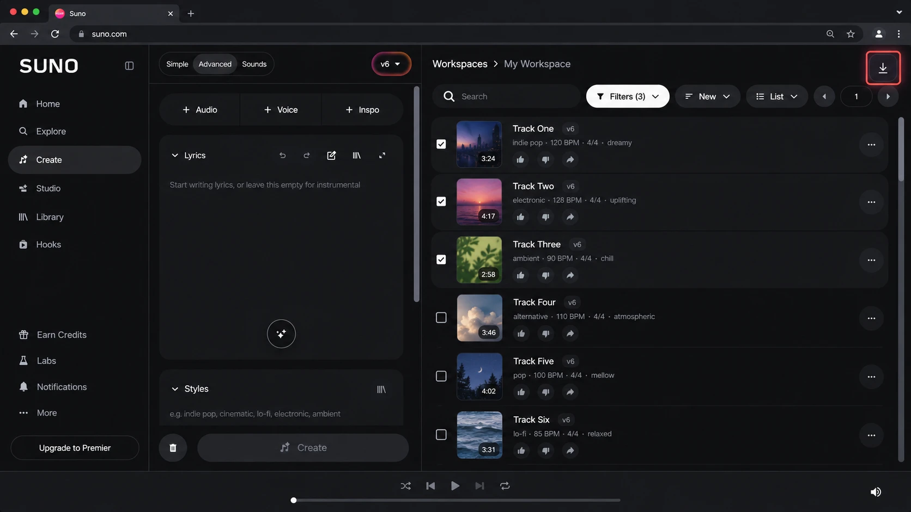
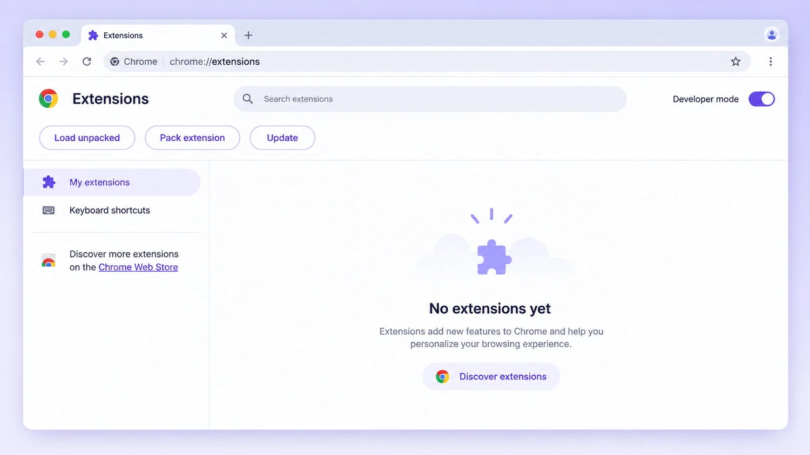
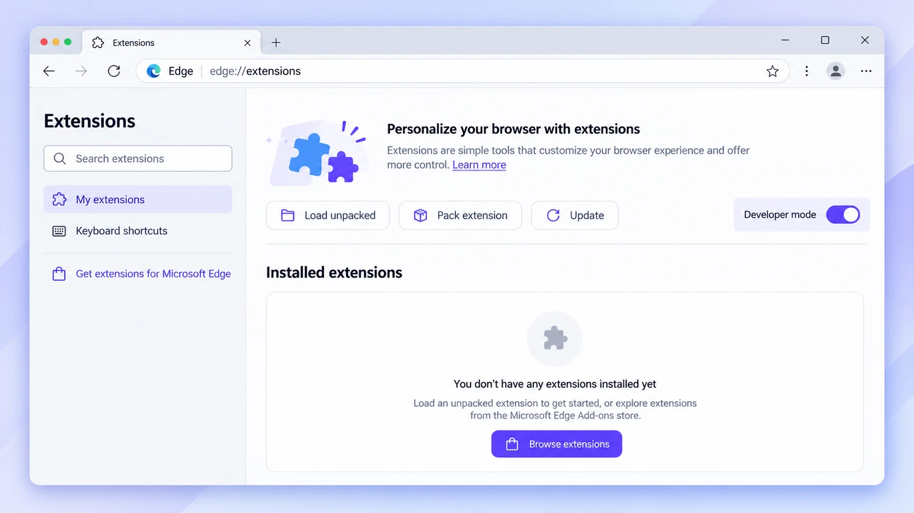
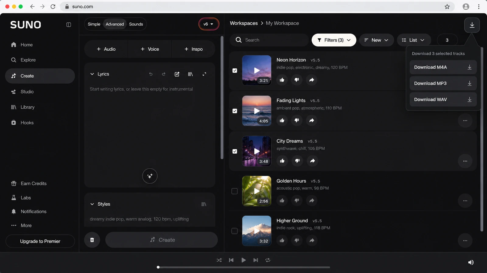

<p align="center">
  <a href="https://sunobatch.com/"></a>
</p>

<h1 align="center">SunoBatch</h1>

<p align="center"><strong>Create. Generate. Download.</strong></p>

<p align="center">
  <strong>One workspace for Suno creators: generate original lyrics, upload finished songs to Suno in batches, and download your tracks without repeating the same steps.</strong>
</p>

<p align="center">
  <a href="https://sunobatch.com/"><strong>🚀 Get Started Free</strong></a> ·
  <a href="https://sunobatch.com/lyrics"><strong>🎵 AI Lyrics Tools</strong></a> ·
  <a href="https://sunobatch.com/extension"><strong>🧩 Chrome / Edge Extension</strong></a> ·
  <a href="https://sunobatch.com/pricing"><strong>💳 Pricing</strong></a>
</p>

<p align="center">
  
  
  
  
</p>

> **Official SunoBatch product overview.** This GitHub repository contains the public product description and screenshots, **not the browser extension source code**. Get the latest extension only from **[sunobatch.com/extension](https://sunobatch.com/extension)**. SunoBatch is independent of Suno, Inc.

---

## Three tools. One connected Suno workflow.

| | Tool | What it does | Batch size |
|---|---|---|---|
| ✨ | **[AI Lyrics Generator](https://sunobatch.com/lyrics)** | Generate original song titles, music styles, and complete lyrics from reusable creative templates. | **Up to 15 songs per generation** |
| 🎼 | **[Upload Lyrics](https://sunobatch.com/lyrics)** | Import a single `.txt` or `.md` file, check multiple songs, then send them to Suno for music creation—without copying each song by hand. | **Up to 50 songs per send** |
| ⬇️ | **[Batch Download](https://sunobatch.com/extension)** | Select your Suno tracks, choose M4A, MP3, or WAV, and follow each export's progress. | **Up to 20 tracks per batch** |

**Create the lyrics on SunoBatch. Generate the audio in your own Suno account. Download the tracks you have the right to export.**

### 1. AI Lyrics Generator — create a full batch, not one song at a time

- Save a **creative template** that you can reuse for future generations.
- Choose how many songs to make and your desired song length.
- Generate a consistent **Song Title / Styles / Lyrics** structure.
- Generate **up to 15 songs in one batch**; a batch counts as **one generation use**, not one use per song.
- Review, copy, or export the results, or send prepared songs to Suno.

Saved creative templates remain available for reuse. Lyrics generated for a batch are intended for the current workflow, rather than a permanent song library.

**[Try AI Lyrics Generator →](https://sunobatch.com/lyrics)**

### 2. Upload Lyrics — 50 songs, without 50 copy-and-paste sessions

Already written your own lyrics, or generated them somewhere else?

- Upload **one `.txt` or `.md` file** containing multiple songs.
- Prepare **up to 50 songs in one send**.
- Review per-song parsing and validation results before sending.
- Send the prepared songs from the SunoBatch website into your Suno creation workflow.
- **Active Creator, Quarterly, and Annual subscribers can use unlimited upload sends** at no extra SunoBatch upload charge. Trial users also have unlimited sends during their eligible trial.
- Uploading existing lyrics **does not consume AI lyric-generation uses**.

The expected song format is:

```text
Song Title
After the Last Train

Styles
Noir jazz, smoky vocal, vintage piano, 86 BPM

Lyrics
[Verse 1]
The platform sleeps beneath the rain
Your last goodbye still calls my name

[Chorus]
I kept the light on one more night
```

The three section labels are **Song Title**, **Styles**, and **Lyrics**. Song styles must stay within the limit shown in the workspace. Check the parsed results before starting a batch.

Uploaded lyrics are processed for the current operation; SunoBatch does not present them as a permanent uploaded-lyrics library.

**[Upload Lyrics →](https://sunobatch.com/lyrics)**

### 3. Batch Download — select once, export together

- Select **1–20 tracks** on Suno instead of repeating individual export actions.
- Download supported formats: **M4A, MP3, and WAV**.
- Track queued, processing, completed, fallback, and failed tasks.
- Only successfully completed downloads count against your SunoBatch download allowance; failed or unfinished downloads do not.
- When temporary processing is unavailable, the workflow can fall back to Suno's official export.

<p align="center">
  <a href="https://sunobatch.com/extension">
    
  </a>
</p>

**[Start batch downloading →](https://sunobatch.com/extension)**

---

## How it works — from lyrics to finished audio

1. **Create your account** at [sunobatch.com](https://sunobatch.com/) and verify your email.
2. **Install SunoBatch** for desktop Chrome or Edge from the [official extension page](https://sunobatch.com/extension).
3. **Sign in to Suno** in your own browser. Your Suno password stays with Suno.
4. **Write or upload lyrics** in the [SunoBatch lyrics workspace](https://sunobatch.com/lyrics), then review the songs.
5. **Send prepared songs to Suno** for audio generation. The browser extension is required for the Suno handoff; Suno generates the music in your Suno account.
6. **Select finished tracks on Suno**, choose M4A / MP3 / WAV, and follow your downloads in the SunoBatch workspace.

You can also use **just the batch downloader** or **just the web-based lyrics preview/export tools** without completing the whole workflow.

### Install the Chrome / Edge extension

Download and extract the ZIP from **[sunobatch.com/extension](https://sunobatch.com/extension)**. Do **not** try to open the ZIP as an extension.

| Chrome | Edge |
|---|---|
|  |  |

1. In Chrome, open `chrome://extensions`. In Edge, open `edge://extensions`.
2. Turn on **Developer mode**.
3. Click **Load unpacked** and select the extracted folder containing `manifest.json`.
4. If Suno is already open, **refresh its tab**.
5. On Suno, the SunoBatch download icon appears at the **top-right of the page**—not necessarily in the browser toolbar.
6. To download, **select your Suno tracks first**, then click the SunoBatch download icon and choose a format.

<p align="center">
  
</p>

> **Updating?** Download the latest ZIP from the official page, extract it, replace the existing extension folder or choose the new folder, click **Reload** at `chrome://extensions` or `edge://extensions`, and refresh Suno.

---

## Plans & allowances

| Plan | Price | Successful downloads | AI lyrics generator | Upload lyrics |
|---|---:|---|---|---|
| **Free** | **$0** | 5 total, lifetime | 2 uses, lifetime | 2 sends, lifetime |
| **Creator** | **$9.90/month** | 30/day | 3 uses/day | **Unlimited sends** |
| **Quarterly** | **$27/quarter** | 50/day | 6 uses/day | **Unlimited sends** |
| **Annual** | **$100/year** | Unlimited while active | 10 uses/day | **Unlimited sends** |
| **Download Pack** | **$2.99 once** | +100 additional downloads, never expire | See current account entitlement | See current account entitlement |

- **One AI generation use = one batch of up to 15 songs.**
- **One upload send = one batch of up to 50 songs.** Paid subscription plans include unlimited upload sends while active.
- The **Creator plan includes a 7-day free trial** for eligible first-time trial users; eligible trial access includes unlimited upload sends.
- The **Free download allowance is 5 successful downloads total**, **not 5 per day**.
- A **Download Pack** is a one-time purchase, not a subscription. When eligible, pack downloads are used after the plan's download allowance.
- Plan availability, trial eligibility, and prices are governed by the **[live pricing page](https://sunobatch.com/pricing)**.

**[Compare plans and prices →](https://sunobatch.com/pricing)**

---

## Privacy, security & permissions

**You stay signed in to Suno using your own Suno account.** SunoBatch does not request or store your Suno password or Suno cookies.

For download tasks, SunoBatch may temporarily process:

- Track IDs and export formats
- Short-lived download tokens
- Audio bytes needed to complete the requested download
- Task status and quota-validation data

Temporary audio bytes are not retained as long-term hosted copies. Lyrics batches are intended to be temporary; **saved creative templates are a separate, persistent feature**. See the [Privacy Policy](https://sunobatch.com/privacy) for current retention details.

The extension uses browser permissions for tab and selection handling, scripting, extension storage, downloads, alarms, and offscreen processing. See the full explanation on the [extension setup page](https://sunobatch.com/extension).

---

## Frequently asked questions

<details>
<summary><strong>Does SunoBatch make the audio?</strong></summary>

No. Suno generates the audio inside **your own Suno account**. SunoBatch helps prepare and send your songs, then organize permitted downloads.

</details>

<details>
<summary><strong>Do I need the extension to use the lyrics tools?</strong></summary>

You can prepare, preview, copy, and export lyrics on the website. To **send songs to Suno** through the connected workflow, install the Chrome / Edge extension and sign in to Suno.

</details>

<details>
<summary><strong>How many songs can I generate or upload at a time?</strong></summary>

The AI Lyrics Generator supports **up to 15 songs per generation batch**. Upload Lyrics supports **up to 50 prepared songs per send**. Batch downloads support **up to 20 tracks per download task**. These are three different limits.

</details>

<details>
<summary><strong>Does uploading my own lyrics use AI generation credits?</strong></summary>

No. Uploading existing lyrics and AI lyrics generation are separate allowances. Active Creator, Quarterly, and Annual plans include unlimited upload sends.

</details>

<details>
<summary><strong>Why are the audio-format actions disabled?</strong></summary>

Select one or more tracks **on Suno first**, then open the SunoBatch download panel.

</details>

<details>
<summary><strong>Why is the download icon not appearing?</strong></summary>

Make sure the extension is enabled. Reload the extension from the browser's extension settings, then **refresh the open Suno tab**. The SunoBatch download icon is shown on the Suno page itself.

</details>

<details>
<summary><strong>Can I use SunoBatch on Safari, Firefox, or mobile?</strong></summary>

The currently documented, tested installation flow supports **desktop Google Chrome and Microsoft Edge on Windows and macOS**.

</details>

<details>
<summary><strong>Can I export any Suno track?</strong></summary>

Export only tracks you own or have permission to download. Commercial usage rights depend on your Suno plan and applicable terms, not on SunoBatch.

</details>

---

## Official links

- 🌐 **Website:** https://sunobatch.com/
- ✨ **AI Lyrics Tools:** https://sunobatch.com/lyrics
- 🧩 **Extension & installation:** https://sunobatch.com/extension
- 💳 **Plans & Download Pack:** https://sunobatch.com/pricing
- 🔒 **Privacy Policy:** https://sunobatch.com/privacy
- ✉️ **Support:** support@sunobatch.com

<p align="center">
  <a href="https://sunobatch.com/"></a>
</p>

<h3 align="center">Spend less time copying, clicking, and tracking. More time making music.</h3>

<p align="center">
  <a href="https://sunobatch.com/"><strong>🚀 Get Started Free</strong></a>
  &nbsp;·&nbsp;
  <a href="https://sunobatch.com/lyrics"><strong>🎼 Open Lyrics Tools</strong></a>
  &nbsp;·&nbsp;
  <a href="https://sunobatch.com/extension"><strong>⬇️ Get Extension</strong></a>
</p>

---

<sub>SunoBatch is an independent third-party product, not affiliated with, endorsed by, or sponsored by Suno, Inc. Suno is a product of Suno, Inc. Product limits and prices may change; the official website is the source for current terms.</sub>
